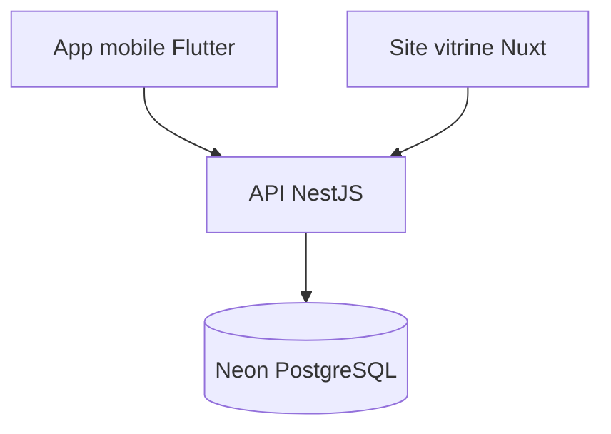

# WELLY

> Une plateforme pour consulter et réserver des maisons et des appartements, avec une seule application mobile pour les acheteurs **et** les vendeurs, et un site web vitrine pour présenter le projet.

---

## Présentation

**WELLY** est une application qui met en relation des personnes qui cherchent un logement (**acheteurs**) et des personnes qui proposent des biens (**vendeurs**).

Tout le monde utilise la même application mobile :

- Par défaut, un utilisateur est **acheteur** : il consulte les annonces et réserve des biens.
- Il peut à tout moment **devenir vendeur** depuis son compte pour publier et gérer ses propres annonces.

À côté de l'application, un **site web vitrine** explique le projet, son fonctionnement et redirige vers le téléchargement de l'application.

---

## Objectifs

- Faciliter la recherche et la réservation de maisons et d'appartements.
- Permettre à n'importe qui de publier un bien simplement, sans créer un second compte.
- Offrir une expérience fluide sur mobile (iOS et Android) avec un seul code source.
- Présenter clairement le projet au grand public via un site web.

---

## Architecture du projet

Le projet est composé de trois parties qui partagent la même base de données et la même API.

```
┌──────────────────┐        ┌──────────────────┐
│  App mobile      │        │  Site vitrine    │
│  (Flutter)       │        │  (Nuxt)          │
│  Acheteur+Vendeur│        │  Présentation    │
└────────┬─────────┘        └──────────────────┘
         │
         ▼
┌──────────────────┐
│  API / Backend   │
└────────┬─────────┘
         │
         ▼
┌──────────────────┐
│  Base de données │
└──────────────────┘
```

### 1. Application mobile (Flutter)

Application unique pour les deux rôles.

**Côté acheteur (par défaut)**
- Inscription et connexion
- Recherche de biens avec filtres (ville, prix, type, nombre de pièces...)
- Consultation de la fiche détaillée d'un bien (photos, description, localisation)
- Réservation d'un bien
- Favoris
- Suivi de ses réservations

**Côté vendeur (activable depuis le compte)**
- Passage du mode acheteur au mode vendeur
- Création, modification et suppression d'annonces
- Ajout de photos
- Gestion des demandes de réservation
- Suivi de ses annonces

### 2. Site web vitrine (Nuxt)

Site d'information, sans espace utilisateur.

- Page d'accueil présentant le projet
- Explication du fonctionnement (acheteur, vendeur, réservation)
- Liens vers le téléchargement de l'application
- Page de contact / FAQ

### 3. Backend et base de données

- API développée avec NestJS (`api_project/`), utilisée par l'application mobile
- Gestion des rôles, des annonces et des réservations
- Authentification (inscription, connexion) gérée par Neon
- Stockage des données et des images
- **État actuel : itération 1 en cours** — authentification et gestion des annonces disponibles ; réservations et upload d'images à venir. Voir `api_project/README.md` pour le setup et la liste des endpoints.
> La base de données est hébergée sur **Neon** (PostgreSQL), qui prend aussi en charge l'authentification. L'API est développée par nos soins avec **NestJS**.

---

## Technologies

| Partie | Technologie |
|---|---|
| Application mobile | [Flutter](https://flutter.dev) |
| Site vitrine | [Nuxt](https://nuxt.com) |
| Backend / API | [NestJS](https://nestjs.com) |
| Base de données | [Neon](https://neon.tech) (PostgreSQL) |
| Authentification | [Neon](https://neon.tech) |

---

## Architecture (Mermaid)



## Fonctionnalités

- Consultation et réservation de maisons/appartements
- Rôle acheteur par défaut, passage en vendeur depuis le compte
- Publication/gestion d'annonces avec photos
- Authentification via Neon

## Setup

### Backend
```bash
cd api_project
npm install
cp .env.example .env
npm run start:dev
```

### Site vitrine
```bash
cd dev-project
npm install
npm run dev
```

### Mobile
```bash
cd mobile_project
flutter pub get
flutter run
```

## Captures d'écran

- `docs/screenshots/home.png` (placeholder)
- `docs/screenshots/listing.png` (placeholder)
- `docs/screenshots/detail.png` (placeholder)

## Liens démo

- Site vitrine : à déployer (Vercel/Netlify)
- API : à déployer (Render/Fly.io)
- App mobile : à publier (Play Store / App Store)

## Actions manuelles restantes

- Créer les secrets GitHub (NEON_DATABASE_URL, etc.)
- Configurer l'hébergement et les déploiements
- Publier l'app mobile sur les stores
- Fournir les captures d'écran réelles

## Licence

À définir.

---

## Auteur

Projet réalisé par **[Ton nom]**.
